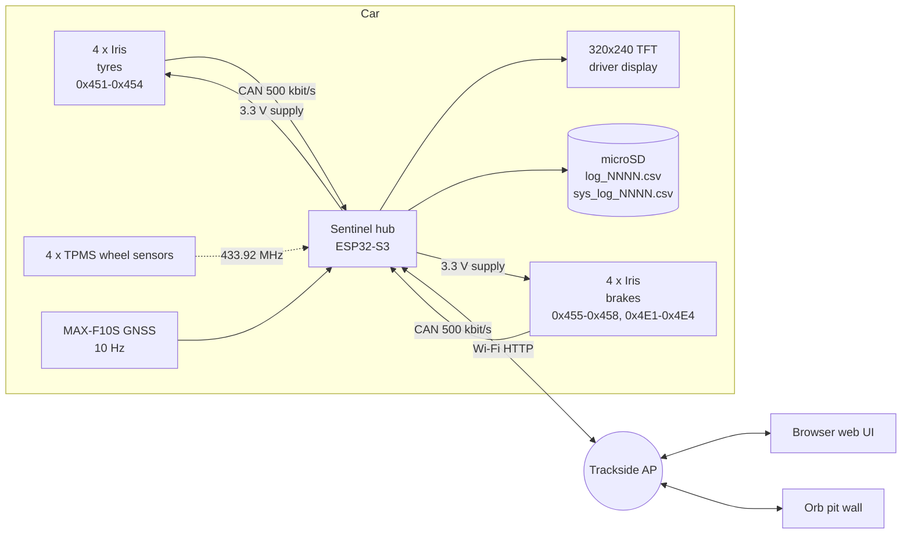
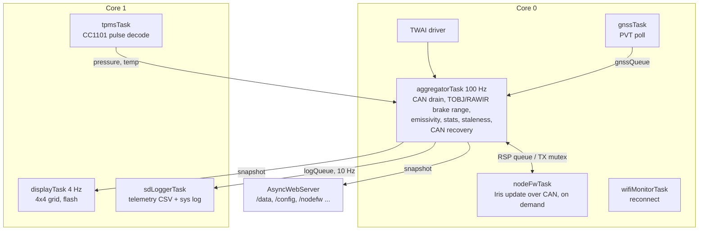

**Sentinel - Brake & Tyre Temperature & Pressure Monitor**

In-car hub that shows brake temperature, tyre temperature and tyre pressure at all four corners on one screen. Sentinel collects eight [Iris](https://github.com/redc6t/Iris) infrared sensors over CAN and four tyre pressure sensors over 433 MHz radio. It shows them on a 320×240 colour display laid out like the car seen from above, logs them with GNSS position at 10 Hz to microSD, and serves them over Wi-Fi to a browser and to the pit wall.

Part of the Mullaloo Motorsport Engineering in-car system, alongside [Iris](https://github.com/redc6t/Iris) (CAN Infrared Temperature Sensor) and [Agile](https://github.com/redc6t/Agile) (Predictive Lap Timer with micro-sector analysis). Consumed by [Orb](https://github.com/redc6t/Orb) (Pit Wall Strategy Manager).

| Sentinel v1.4 | Rear panel |
|---|---|
|  |  |

**Features**

- Eight temperature channels over CAN (500 kbit/s): one Iris node per tyre and per brake, 50 frames a second each
- Brake temperatures up to about 580-600 °C. Above the infrared sensor's own limit (440 °C displayed), Sentinel switches to the sensor's raw infrared signal, calibrated per brake from track data. See *Brake temperature range* below
- Emissivity correction per channel type (brakes 0.70, tyres 0.92), with min, max, average and standard deviation per channel
- Tyre pressure and tyre air temperature from the car's 433 MHz TPMS sensors (CC1101 receiver, Schrader-layout frames), with a pressure change against the first reading of the session
- 4×4 colour grid: tyre and brake temperatures on the outer rows, pressures and pressure changes in the middle. Each cell is coloured by threshold bands and flashes above the top band
- Thresholds for brakes, tyres and pressure set from the web interface and kept across power cycles
- Dead-sensor safety: a channel silent for 1.5 s shows `---` and logs -1, so a stale reading is never shown as live
- Self-recovering CAN: the hub starts as a silent listener, switches to normal mode once the bus has been stable for 0.5 s, and drops back to listening after 3 s of silence, so a sick bus can recover. Every dropout and return is logged with each node's frame sequence number, which shows whether the nodes stopped sending or the hub stopped hearing them
- Node health readout: with Iris v5.3.0, each node reports its boot count, reset reason, bus-off and recovery counters, chip temperature and how its previous boot ended. Read at power-up and after every bus return
- u-blox MAX-F10S dual-band GNSS (L1/L5) at 10 Hz for time, position and speed
- microSD logging: one telemetry CSV row per GNSS fix (10 Hz) plus a separate system event log per session. A failed write is detected and the log reopens in a new file instead of stopping silently
- Wi-Fi web interface: live values and charts, log list and download, thresholds, Wi-Fi setup, display brightness, TPMS diagnostics
- Firmware update over Wi-Fi for the hub, and for every Iris node over the CAN bus, from the same page. Both are password protected and refused while the car is moving
- Display brightness 10 to 100 % with Day, Dusk and Night presets for night stints (needs the v1.4 backlight modification, see Hardware)

**System overview**



**Display**

The display mirrors the car from above. Front axle on top, rear axle at the bottom, tyres on the outside, brakes on the inside:

| | Left | | | Right |
|---|---|---|---|---|
| **Front** | FL tyre °C | FL brake °C | FR brake °C | FR tyre °C |
| | FL psi | FL Δpsi | FR Δpsi | FR psi |
| | RL psi | RL Δpsi | RR Δpsi | RR psi |
| **Rear** | RL tyre °C | RL brake °C | RR brake °C | RR tyre °C |

Each cell is filled with its band colour: blue (cold), green, yellow, red, and red flashing above the top limit. A pressure-change cell takes the colour of the same wheel's absolute pressure. A pressure older than 2.5 minutes turns grey; after 30 minutes it is removed.

Default bands (all editable in the web Config card):

| Channel | Blue up to | Green up to | Yellow up to | Red up to | Flashing above |
|---|---|---|---|---|---|
| Brake (°C) | 100 | 300 | 500 | 700 | 700 |
| Tyre (°C) | 40 | 70 | 100 | 130 | 130 |
| Pressure (psi) | 20 | 26 | 29 | 32 | 32 |

**CAN bus**

| ID | Source | Content |
|---|---|---|
| 0x451-0x454 | Iris, tyres FL / FR / RL / RR | Object temperature, 50 Hz |
| 0x455-0x458 | Iris, brakes FL / FR / RL / RR | Object temperature, 50 Hz |
| 0x4E1-0x4E4 | Iris, brakes FL / FR / RL / RR | Raw thermopile and sensor ambient, 50 Hz. Used for brake temperatures above 350 °C (sensor scale) |
| 0x6A0-0x6B7 | Hub ↔ Iris | Node firmware update and node health readout: commands, responses, data (only on request) |

Frame layout byte by byte: [Iris technical specification](https://github.com/redc6t/Iris/blob/main/Documentation/TechnicalSpec.md).

**Brake temperature range**

Each Iris node carries an MLX90614 infrared sensor. The sensor computes an object temperature (TOBJ) on its own scale, and that scale ends at 382.19 °C, which is 440.67 °C after Sentinel's brake emissivity correction (0.70). Track logs from the 36h Collie (November 2026) showed what happens past that point: TOBJ either sticks at its limit or wraps round to wrong, *low* values. Meanwhile the sensor's raw thermopile signal (RAWIR), read in the same cycle, keeps rising smoothly.

From firmware v4.10.0 the brake reading combines the two:

| Sensor-scale temperature | Brake reading comes from |
|---|---|
| below 350 °C | TOBJ, as before |
| 350 to 375 °C | a linear blend from TOBJ to RAWIR |
| above 375 °C, or whenever TOBJ is at its limit | RAWIR |
| RAWIR at its own limit (32,767 counts) | shown as **MAX** on the display and as e.g. **590+** on the web, because the real value may be higher |

The RAWIR result is emissivity-corrected exactly like TOBJ, so the curve runs continuously through 440 °C.

Calibration fits `RAWIR = A · (Tobj⁴ − Ta⁴) + B` per brake (temperatures in kelvin, Ta is the sensor's own body temperature). It uses about 53,000 samples from the 36h Collie, on the part of the range where TOBJ is still reliable (200 to 381 °C):

| Brake | A | B | Error, TOBJ 340-381 °C |
|---|---|---|---|
| FL | 8.367e-8 | 2067 | bias −2.4 °C, p95 6.6 °C |
| FR | 8.005e-8 | 2054 | bias −2.4 °C, p95 7.7 °C |
| RL | 7.782e-8 | 2175 | bias −1.8 °C, p95 7.2 °C |
| RR | 8.182e-8 | 2236 | bias −1.7 °C, p95 7.4 °C |

- The four nodes agree within 8 %. A node without its own fit uses their average.
- Sensor body temperature has no measurable effect between 14 and 121 °C.
- The top of the range depends on the brake and the sensor body temperature: about 581-604 °C displayed.

Replayed over the 36h Collie logs, the combined reading shows the brakes in stint 1 above 440 °C for about three quarters of track time, peaking at 529-596 °C. For 20-38 % of that stint the old graph had read more than 40 °C too low. Above 440 °C, readings extend the sensor's own scale and carry the same emissivity assumption as every brake reading: at the ceiling, emissivity 0.6 / 0.7 / 0.8 / 0.9 gives about 629 / 595 / 567 / 543 °C. They have not yet been checked against a thermocouple.

**Updating Iris nodes over CAN**

From the web page's *Sensor Node Firmware (CAN)* card: upload the node `.bin`, query the nodes, then update one corner or all eight. The hub checks the image before sending anything (ESP32-C3 image, SHA-256 present, size, Iris firmware tag). Each node is sent the image in checked blocks, reboots, and must report the new version within 75 s; otherwise it rolls back to its old firmware. *Update all* goes one node at a time and stops at the first node that does not verify, so a bad image never reaches a second corner. About 70 s per node. Needs Iris firmware v5.1.0 or later. The node health readout on the same card needs Iris v5.3.0.

**Firmware architecture**



**Web interface and API**

Open the unit's IP address in a browser on the same network. Main endpoints:

| Endpoint | Use |
|---|---|
| `GET /` | Web interface |
| `GET /data` | Live JSON: temperatures, statistics, pressures, GNSS, CAN and system status (polled by Orb) |
| `GET /logslist`, `/view`, `/download` | List, preview and download SD logs |
| `GET`/`POST /config`, `POST /config/reset` | Threshold bands |
| `GET`/`POST /wifi`, `POST /wifi/reset` | Wi-Fi network |
| `GET`/`POST /brightness` | Display brightness |
| `GET /tpms`, `/tpms/rebase` | TPMS status, reset the pressure baseline |
| `GET /nodefw`, `POST /nodefw/*` | Iris firmware update over CAN |
| `GET`/`POST /update`, `POST /reboot` | Hub firmware update and restart (password protected) |

**Logging**

Each session opens `log_NNNN.csv` and `sys_log_NNNN.csv` with the same number.

**Telemetry log:** one row per GNSS fix (10 Hz), containing:
- date, time, and the eight temperatures;
- latitude, longitude, speed, satellites and PDOP;
- raw infrared counts and sensor body temperatures;
- CAN health counters and CAN mode;
- the four tyre pressures and air temperatures;
- from v4.10.0, a source column per brake: `T` sensor temperature, `B` blend, `R` raw infrared, `C` ceiling.

A missing value is written as -1.00. If a write fails, the hub logs it and carries on in `log_NNNN_b.csv` (then `_c`, ...).

**System log:**
- events: CAN dropouts and returns with node sequence numbers, node health and error-counter levels, CAN error states;
- a vitals line and a CAN summary every minute;
- a brake-source summary each minute that raw infrared was in use;
- a logging summary every 10 minutes;
- TPMS diagnostics.

**Hardware**

| Component | Part | Interface |
|---|---|---|
| MCU | ESP32-S3-WROOM-1-N16R8 (16 MB flash, 8 MB OPI PSRAM) | - |
| Display | 320×240 TFT, ILI9341 | SPI |
| GNSS | u-blox MAX-F10S (GPS L1/L5, Galileo E1/E5a, BeiDou B1C/B2a, QZSS) | UART, 115200 baud |
| CAN | TI TCAN3413DR, ESD2CAN24 protection; termination external on J12 | TWAI, 500 kbit/s |
| TPMS receiver | TI CC1101, 433.92 MHz, receive-only | SPI (HSPI) |
| Storage | microSD | SPI |
| Power | Maxim MAX25223 | 3 to 36 V DC input |

Board revision v1.4, firmware v4.10.0 (paired with Iris v5.3.0). All PCB designs are custom.

Iris nodes are powered with 3.3 V from Sentinel through the CAN connector (pin 1) and have no regulator of their own. See [Hardware](Hardware/README.md) and the [PCB changelog](Hardware/pcb_changelog.txt).


**Status**

Board v1.4. On track through the 36h Collie (12-14 November 2026) with firmware v4.7.0 and Iris v5.1.0. The next pair is Sentinel v4.10.0 with Iris v5.3.0: written and compiled, with the bench test pending.

- **TPMS:** worked all weekend. About 5,700 checked frames were decoded across the four wheels, with pressure valid on 85-96 % of logged rows during the long stints. The rear-left sensor is received least often: the 433 MHz antenna is a flex antenna stuck to the back of the PCB, and moving it off the board or through the enclosure is the fix.
- **CAN dropouts:** being fixed in firmware, trigger still open. See *Field results* below.
- **Extended brake range:** calibrated from the 36h Collie and switched on in v4.10.0, up to about 590 °C. A thermocouple check is still to be done.
- **Display brightness:** needs a P-channel MOSFET added on v1.4 to switch the display backlight from GPIO38. On an unmodified board the control reports "not fitted". To be designed into the next board.

**Field results: 36h Collie, November 2026**

36 hours of endurance racing. The hub ran 20.5 hours without a restart in one stretch.

What worked:
- **TPMS:** all four wheels tracked for the whole event.
- **GNSS:** steady at 10 Hz, 19-22 satellites, PDOP about 1.1.
- **CAN recovery:** the hub's recovery logic brought the bus back on its own 47 times without ever jamming it.
- **System log:** kept writing through everything.

What was found and changed:

- **Whole-bus CAN silences (49):** all eight nodes, tyres and brakes alike, stopped within 10-60 ms and came back together, minutes to hours later, without rebooting.
  - Not brake heat: it happened with the hottest brake node gone, and at every sensor temperature.
  - The long silences come from the node firmware. Iris v5.1.0 started bus-off recovery but never timed it out, and sent nothing while it waited.
  - **Iris v5.3.0** bounds every recovery to seconds and retries forever. It also adds a transmit watchdog and a black box readable from Sentinel.
  - What puts every node into bus-off in the first place is still under investigation. Sentinel v4.9.0+ logs the evidence needed: node sequence numbers at every dropout, and node health after every return.
- **Telemetry CSV stopped writing silently** in three sessions (19 h, 2 h and 5.5 h lost) while the system log on the same card kept going. **v4.9.0** detects a failed write and reopens the log.
- **Brake readings above the sensor limit were wrong.** Brakes ran well past 440 °C, and the sensor's own temperature output wrapped to low values. **v4.10.0** uses the calibrated raw infrared signal instead (see *Brake temperature range* above).
- **One brake node (FL) failed** during the event. It had run the hottest, with its sensor body at 113-117 °C against the MLX90614's 125 °C rating. It is being bench-checked.

Full analysis: [Sessions/131126_36h_Collie/ANALYSIS_36h_Collie.md](Sessions/131126_36h_Collie/ANALYSIS_36h_Collie.md).

**Documentation**

| Document | Contents |
|---|---|
| [Hardware](Hardware/README.md) | Folder layout, core components, file naming |
| [PCB changelog](Hardware/pcb_changelog.txt) | Board revision history |
| [Flowcharts](Documentation/Flowchart/) | System flowchart and CAN loop diagrams (draw.io) |
| [Product manual v1.9.1](Documentation/Manuals/BTTM_Product_Manual_v1.9.1.pdf) | Earlier manual, written before TPMS, GNSS F10 and node updates |
| [FreeRTOS timing notes](Firmware/FreeRTOS_Timing_Semantics.txt) | Task timing semantics |

**Repository layout**

```text
Sentinel/
├── README.md                 this file
├── LICENSE
├── Documentation/
│   ├── Flowchart/            system flowchart, CAN loop diagrams (draw.io, PDF)
│   └── Manuals/              product manual
├── Firmware/
│   ├── LICENSE               firmware licence (source not published)
│   └── ...                   design notes and earlier firmware pseudocode
├── Sessions/                 track session logs and analyses, one folder per event
├── Hardware/
│   ├── PCB/                  schematic and board PDFs, 3D STEP
│   ├── Fabrication/          Gerber, BOM, CPL per revision
│   ├── Enclosure/            enclosure STEP (v1.4)
│   ├── Datasheets/
│   └── pcb_changelog.txt
└── Photos-Journal_Megadump/  build journal photos, one folder per milestone
```

**Applications**

Designed for circuit racing, track days and motorsport testing, giving brake temperatures, tyre temperatures and tyre pressures at every corner for race strategy, vehicle setup and R&D.

**License**

| Part | Licence |
|---|---|
| Hardware (schematics, PCB, fabrication files, enclosure) | [CERN-OHL-S-2.0](https://ohwr.org/cern_ohl_s_v2.txt) |
| Documentation (including any firmware pseudocode and diagrams) | [CC BY 4.0](https://creativecommons.org/licenses/by/4.0/) |
| Firmware (source and binaries) | Proprietary, all rights reserved. The source is not published; binaries are free to use on Sentinel hardware. See [Firmware/LICENSE](Firmware/LICENSE). |

See [LICENSE](LICENSE) for details.

By: Pietro Gambarin (pietro.gambarin@gmail.com)
