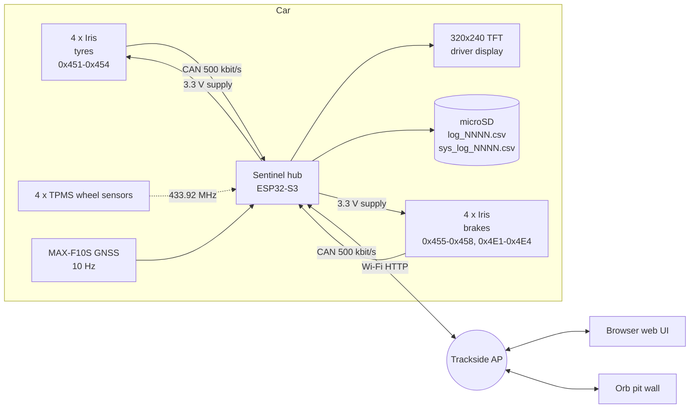
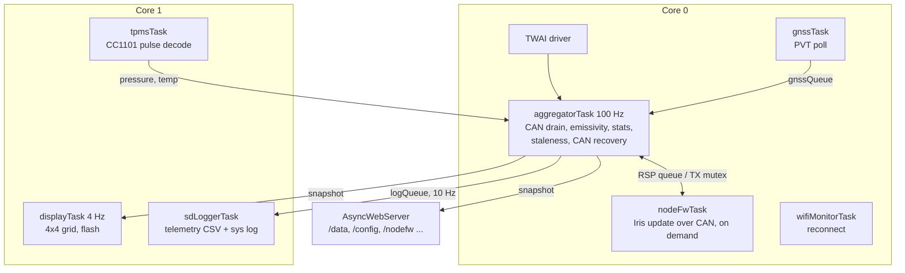

**Sentinel - Brake & Tyre Temperature & Pressure Monitor**

In-car hub that shows brake temperature, tyre temperature and tyre pressure at all four corners on one screen. Sentinel collects eight [Iris](https://github.com/redc6t/Iris) infrared sensors over CAN and four tyre pressure sensors over 433 MHz radio. It shows them on a 320×240 colour display laid out like the car seen from above, logs them with GNSS position at 10 Hz to microSD, and serves them over Wi-Fi to a browser and to the pit wall.

Part of the Mullaloo Motorsport Engineering in-car system, alongside [Iris](https://github.com/redc6t/Iris) (CAN Infrared Temperature Sensor) and [Agile](https://github.com/redc6t/Agile) (Predictive Lap Timer with micro-sector analysis). Consumed by [Orb](https://github.com/redc6t/Orb) (Pit Wall Strategy Manager).

| Sentinel v1.4 | Rear panel |
|---|---|
|  |  |

**Features**

- Eight temperature channels over CAN (500 kbit/s): one Iris node per tyre and per brake, 50 frames a second each
- Emissivity correction per channel type (brakes 0.70, tyres 0.92), with min, max, average and standard deviation per channel
- Tyre pressure and tyre air temperature from the car's 433 MHz TPMS sensors (CC1101 receiver, Schrader-layout frames), with a pressure change against the first reading of the session
- 4×4 colour grid: tyre and brake temperatures on the outer rows, pressures and pressure changes in the middle. Each cell is coloured by threshold bands and flashes above the top band
- Thresholds for brakes, tyres and pressure set from the web interface and kept across power cycles
- Dead-sensor safety: a channel silent for 1.5 s shows `---` and logs -1, so a stale reading is never shown as live
- Self-recovering CAN: the hub starts as a silent listener, switches to normal mode on the first frame, and drops back to listening after 3 s of silence, so a sick bus can recover
- u-blox MAX-F10S dual-band GNSS (L1/L5) at 10 Hz for time, position and speed
- microSD logging: one telemetry CSV row per GNSS fix (10 Hz) plus a separate system event log per session
- Wi-Fi web interface: live values and charts, log list and download, thresholds, Wi-Fi setup, display brightness, TPMS diagnostics
- Firmware update over Wi-Fi for the hub, and for every Iris node over the CAN bus, from the same page. Both are password protected and refused while the car is moving
- Display brightness 10 to 100 % with Day, Dusk and Night presets for night stints (needs the v1.4 backlight modification, see Hardware)

**System overview**



**Display**

The display mirrors the car from above. Front axle on top, rear axle at the bottom, tyres on the outside, brakes on the inside:

| | Left | | | Right |
|---|---|---|---|---|
| **Front** | FL tyre °C | FL brake °C | FR brake °C | FR tyre °C |
| | FL psi | FL Δpsi | FR Δpsi | FR psi |
| | RL psi | RL Δpsi | RR Δpsi | RR psi |
| **Rear** | RL tyre °C | RL brake °C | RR brake °C | RR tyre °C |

Each cell is filled with its band colour: blue (cold), green, yellow, red, and red flashing above the top limit. A pressure-change cell takes the colour of the same wheel's absolute pressure. A pressure older than 2.5 minutes turns grey; after 30 minutes it is removed.

Default bands (all editable in the web Config card):

| Channel | Blue up to | Green up to | Yellow up to | Red up to | Flashing above |
|---|---|---|---|---|---|
| Brake (°C) | 100 | 300 | 500 | 700 | 700 |
| Tyre (°C) | 40 | 70 | 100 | 130 | 130 |
| Pressure (psi) | 20 | 26 | 29 | 32 | 32 |

**CAN bus**

| ID | Source | Content |
|---|---|---|
| 0x451-0x454 | Iris, tyres FL / FR / RL / RR | Object temperature, 50 Hz |
| 0x455-0x458 | Iris, brakes FL / FR / RL / RR | Object temperature, 50 Hz |
| 0x4E1-0x4E4 | Iris, brakes FL / FR / RL / RR | Raw thermopile and ambient, for the extended range (calibration pending) |
| 0x6A0-0x6B7 | Hub ↔ Iris | Node firmware update: commands, responses, data (only during an update) |

Frame layout byte by byte: [Iris technical specification](https://github.com/redc6t/Iris/blob/main/Documentation/TechnicalSpec.md).

**Updating Iris nodes over CAN**

From the web page's *Sensor Node Firmware (CAN)* card: upload the node `.bin`, query the nodes, then update one corner or all eight. The hub checks the image before sending anything (ESP32-C3 image, SHA-256 present, size, Iris firmware tag). Each node is sent the image in checked blocks, reboots, and must report the new version within 75 s; otherwise it rolls back to its old firmware. *Update all* goes one node at a time and stops at the first node that does not verify, so a bad image never reaches a second corner. About 70 s per node. Needs Iris firmware v5.1.0 or later.

**Firmware architecture**



**Web interface and API**

Open the unit's IP address in a browser on the same network. Main endpoints:

| Endpoint | Use |
|---|---|
| `GET /` | Web interface |
| `GET /data` | Live JSON: temperatures, statistics, pressures, GNSS, CAN and system status (polled by Orb) |
| `GET /logslist`, `/view`, `/download` | List, preview and download SD logs |
| `GET`/`POST /config`, `POST /config/reset` | Threshold bands |
| `GET`/`POST /wifi`, `POST /wifi/reset` | Wi-Fi network |
| `GET`/`POST /brightness` | Display brightness |
| `GET /tpms`, `/tpms/rebase` | TPMS status, reset the pressure baseline |
| `GET /nodefw`, `POST /nodefw/*` | Iris firmware update over CAN |
| `GET`/`POST /update`, `POST /reboot` | Hub firmware update and restart (password protected) |

**Logging**

Each session opens `log_NNNN.csv` and `sys_log_NNNN.csv` with the same number. The telemetry log has one row per GNSS fix (10 Hz): date, time, the eight temperatures, latitude, longitude, speed, satellites, PDOP, raw infrared counts, CAN health counters and CAN mode, and the four tyre pressures and air temperatures. A missing value is written as -1.00. The system log records events, a vitals line every minute and TPMS diagnostics.

**Hardware**

| Component | Part | Interface |
|---|---|---|
| MCU | ESP32-S3-WROOM-1-N16R8 (16 MB flash, 8 MB OPI PSRAM) | - |
| Display | 320×240 TFT, ILI9341 | SPI |
| GNSS | u-blox MAX-F10S (GPS L1/L5, Galileo E1/E5a, BeiDou B1C/B2a, QZSS) | UART, 115200 baud |
| CAN | TI TCAN3413DR, ESD2CAN24 protection; termination external on J12 | TWAI, 500 kbit/s |
| TPMS receiver | TI CC1101, 433.92 MHz, receive-only | SPI (HSPI) |
| Storage | microSD | SPI |
| Power | Maxim MAX25223 | 3 to 36 V DC input |

Board revision v1.4, firmware v4.6.2. All PCB designs are custom. See [Hardware](Hardware/README.md) and the [PCB changelog](Hardware/pcb_changelog.txt).


**Status**

Board v1.4, firmware v4.6.2, in use on track.

- **TPMS:** decoding is complete; every captured frame is recovered. The rear sensors are at the edge of range because the 433 MHz antenna is a flex antenna stuck to the back of the PCB. The fix is mechanical: move the antenna off the board or use an external antenna through the enclosure. Pressure scaling is still to be confirmed against a gauge on an inflated tyre.
- **Display brightness:** needs a P-channel MOSFET added on v1.4 to switch the display backlight from GPIO38. On an unmodified board the control reports "not fitted". To be designed into the next board.
- **Extended brake range:** raw infrared extrapolation above about 380 °C is built in but switched off until it is calibrated on track.
- **v4.6.x:** the Iris update over CAN (v4.6.0), the browser upload login fix (v4.6.1) and the web route fix (v4.6.2) were tested on the host. Bench confirmation on the unit is pending.

**Documentation**

| Document | Contents |
|---|---|
| [Hardware](Hardware/README.md) | Folder layout, core components, file naming |
| [PCB changelog](Hardware/pcb_changelog.txt) | Board revision history |
| [Flowcharts](Documentation/Flowchart/) | System flowchart and CAN loop diagrams (draw.io) |
| [Product manual v1.9.1](Documentation/Manuals/BTTM_Product_Manual_v1.9.1.pdf) | Earlier manual, written before TPMS, GNSS F10 and node updates |
| [FreeRTOS timing notes](Firmware/FreeRTOS_Timing_Semantics.txt) | Task timing semantics |

**Repository layout**

```text
Sentinel/
├── README.md                 this file
├── LICENSE
├── Documentation/
│   ├── Flowchart/            system flowchart, CAN loop diagrams (draw.io, PDF)
│   └── Manuals/              product manual
├── Firmware/
│   ├── LICENSE               firmware licence (source not published)
│   └── ...                   design notes and earlier firmware pseudocode
├── Hardware/
│   ├── PCB/                  schematic and board PDFs, 3D STEP
│   ├── Fabrication/          Gerber, BOM, CPL per revision
│   ├── Enclosure/            enclosure STEP (v1.4)
│   ├── Datasheets/
│   └── pcb_changelog.txt
└── Photos-Journal_Megadump/  build journal photos, one folder per milestone
```

**Applications**

Designed for circuit racing, track days and motorsport testing, giving brake temperatures, tyre temperatures and tyre pressures at every corner for race strategy, vehicle setup and R&D.

**License**

| Part | Licence |
|---|---|
| Hardware (schematics, PCB, fabrication files, enclosure) | [CERN-OHL-S-2.0](https://ohwr.org/cern_ohl_s_v2.txt) |
| Documentation (including any firmware pseudocode and diagrams) | [CC BY 4.0](https://creativecommons.org/licenses/by/4.0/) |
| Firmware (source and binaries) | Proprietary, all rights reserved. The source is not published; binaries are free to use on Sentinel hardware. See [Firmware/LICENSE](Firmware/LICENSE). |

See [LICENSE](LICENSE) for details.

By: Pietro Gambarin (pietro.gambarin@gmail.com)
